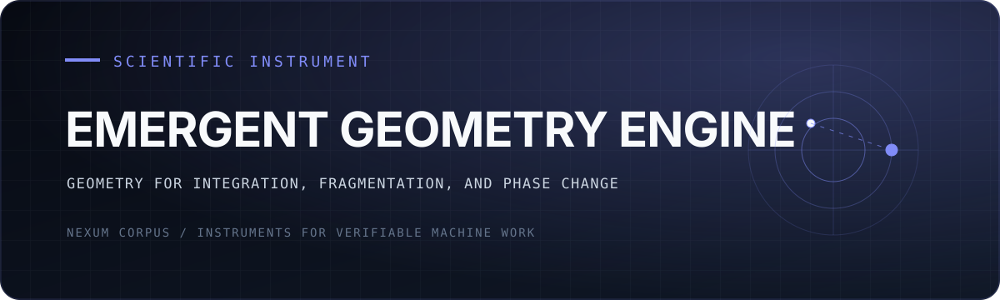

<div align="center">
  

  <p><strong>Turn correlation into geometry—and geometry into an instrument for phase change.</strong></p>

  <p><a href="#what-it-measures">What it measures</a> · <a href="#quickstart">Quickstart</a> · <a href="#phase-gates">Phase gates</a> · <a href="https://github.com/NexumCorpus">Nexum Corpus</a></p>
</div>

---

## What it measures

The Emergent Geometry Engine is a substrate-agnostic instrument that constructs
an emergent geometry from any correlation / similarity matrix, computes its discrete-geometry invariants
(Ollivier / Lin–Lu–Yau & Forman–Ricci curvature, Gromov δ-hyperbolicity, spectral
dimension), embeds it (Euclidean + hyperbolic MDS), and uses those invariants as
**order parameters / early-warning signals** for integration↔fragmentation
transitions.

> **Honest posture.** Calibrated claims only. This is *one shared mathematical
> object* (graph curvature as an integration–fragmentation order parameter)
> applied to two substrates (quantum measurement-induced transitions; neural
> grokking / emergent misalignment). It is an analogy with a shared object, **not**
> a grand-unified theory. Null results are publishable. We say "haven't seen this
> done," never "first."

## Architecture — one kernel, two adapters, two front-ends

```
                 ┌──────────────────────────────────────────────┐
   Adapter Q ──▶ │  KERNEL                                       │ ──▶ Front-end V
 (quantum MI)    │  matrix → kNN graph (+ shortcut-edge prune)   │     (audiovisual)
                 │        → Forman / Ollivier-LLY curvature      │
   Adapter N ──▶ │        → Gromov δ, spectral dimension         │ ──▶ Front-end A
 (neural CKA)    │        → Euclidean MDS + hyperbolic h-MDS      │     (analysis/EWS)
                 └──────────────────────────────────────────────┘
                                    ▲
                                    │ certified by
                 ┌──────────────────────────────────────────────┐
                 │  VERIFIER (separate code path, no kernel imports)
                 │  • entropy-inequality suite
                 │  • Peschel free-fermion cross-check (numpy-only)
                 │  • independent exact-diagonalization cross-check
                 │  • spectral-gap ≥ curvature bound (Lin–Lu–Yau)
                 │  • graph-construction robustness harness
                 └──────────────────────────────────────────────┘
```

## Governing discipline (non-negotiable)

1. **Generator ≠ grader.** The code that *computes* a quantity and the code that
   *certifies* it live on separate paths. The verifier does **not** import the
   kernel. The free-fermion entropy is checked *two mathematically independent
   ways* (correlation-matrix eigenvalues vs. full reduced-density-matrix
   diagonalization) and must agree to `< 1e-9`.
2. **Evidence before claims.** Show the test output / the actual number. Never
   assert success.
3. **Phase-gated.** Each phase has an acceptance gate; do not advance until it
   passes.
4. **Build the verifier alongside the feature.** Failing tests committed first.

## The four robustness fixes (kernel requirements, not options)

1. **Freeze** the Ollivier idleness `α` and the distance threshold as fixed
   constants *before* looking at any results (see `geometry/config.py`).
2. **Zero the dissimilarity diagonal**; use unbiased / cross-validated
   dissimilarity (diagonal entries and within-run correlation fake structure).
3. **k-NN graph + shortcut-edge pruning** *before* computing global curvature / δ.
4. **Forman / effective-resistance curvature for trajectories** (cheap); exact
   Ollivier / LLY only at anchor checkpoints (Wasserstein-LP is costly).

## Phase gates

| Phase | Deliverable | Gate |
|------|-------------|------|
| **0** | Kernel + Verifier + four robustness fixes | Peschel↔independent-ED agreement `<1e-9`; full inequality suite passes; curvature stable under the fixed recipe; spectral-gap bound `λ₁ ≥ κ_min` confirmed on test graphs; robustness harness runs |
| 1 | Track-A hero visual (ring → tear → bridge) | money-shot plays; product state shows no structure; critical chain embeds as a ring/disk |
| 2 | Sonification + interactivity | the tear is audiovisual and demo-able |
| 3 | Track-A MIPT-geometry sweep | clean comparison to I₃; documented signal or honest null |
| 4 | Track-B head-to-head plot (front-loadable) | the deciding figure exists; lead-time assessed honestly |
| 5 | Emergent-misalignment target; hyperbolic hardening; OTOC (stretch) | — |

## Layout

```
geometry/      # the kernel (graph build, curvature, δ, spectral dim, MDS)
verify/        # the verifier — SEPARATE code path, must not import geometry/
adapters/      # Adapter Q (quantum MI), Adapter N (neural CKA)
tests/         # pytest suite (failing tests committed first)
artifacts/     # generated plots / JSON frames (gitignored)
.claude/       # physics-verifier subagent + verification hooks
```

## Quickstart

```bash
.venv/Scripts/python.exe -m verify           # prints PASS/FAIL per check
.venv/Scripts/python.exe -m pytest -q        # full suite
```

QuTiP is an **optional** third cross-check (`pip install qutip`); the core
verifier runs without it via the independent numpy exact-diagonalization path.
